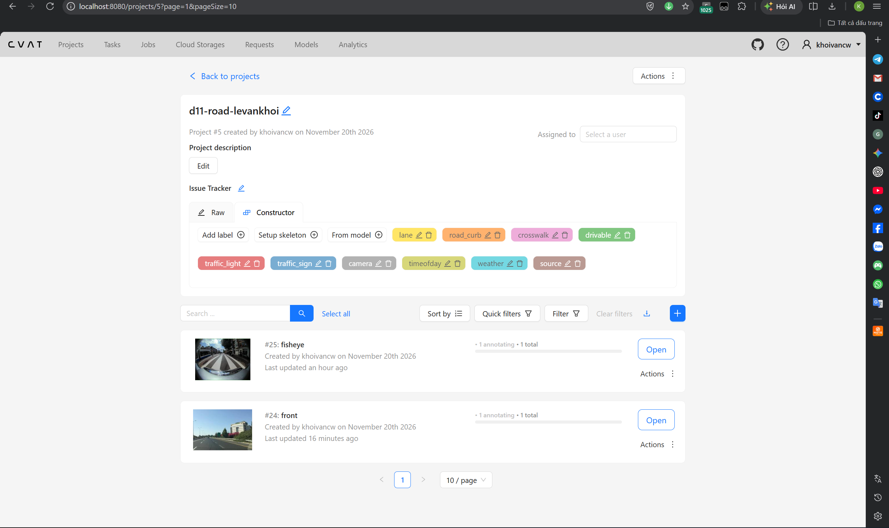
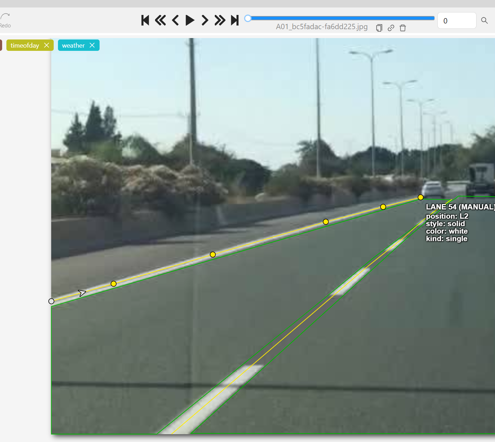
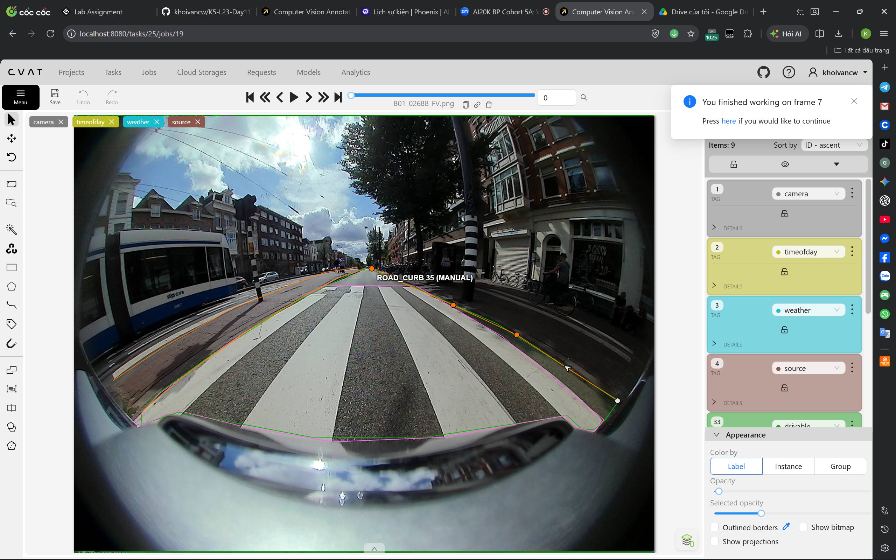
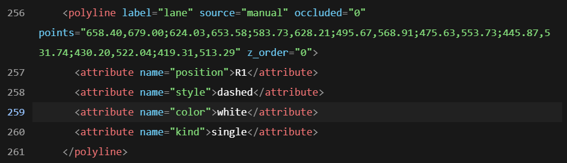

# Báo cáo cá nhân — Ngày 11

Họ tên: **Lê Văn Khởi**  
Mã học viên: **2A202603290**  
CVAT: **2.74.1** · Guideline: **Road v1.0**  
Manifest: **revision 4**.

## 1. Kiểm project

| Mục | Kết quả | Ghi chú |
| --- | --- | --- |
| 6 label, đúng kiểu | Có | lane, road_curb, crosswalk, drivable, traffic_light, traffic_sign |
| Thuộc tính | Đã kiểm và sửa các mục ở phần 3 | Kết quả kiểm file ở mục 5 |
| 4 tag ảnh | Đủ 20 ảnh | camera, timeofday, weather, source |
| Trạng thái job | completed | Front job 18, fisheye job 19 |

Em dùng bản front của Vinh làm mẫu rồi rà soát và chỉnh sửa trên task 24.

Em kết thúc polyline bằng N, đặt tag bằng công cụ Tag và chọn value trong Details.
Em lưu bằng Ctrl+S rồi export.

Thời điểm export:

- Front: **20/11/2026 21:39:45**.
- Fisheye: **20/11/2026 20:58:43**.

## 2. Số lượng đã gán

| Task | Ảnh | lane | road_curb | crosswalk | drivable | traffic_light | traffic_sign | Tổng hình |
| --- | ---: | ---: | ---: | ---: | ---: | ---: | ---: | ---: |
| front | 12 | 26 | 5 | 3 | 26 | 20 | 5 | 85 |
| fisheye | 8 | 5 | 23 | 10 | 6 | 5 | 3 | 52 |
| Tổng | 20 | 31 | 28 | 13 | 32 | 25 | 8 | 137 |

Có **80 tag**: front 48, fisheye 32. Không nộp ảnh thêm trong bộ này.

## 3. Bảng ca khó

| Ảnh | Nhãn | Đã chọn / đã sửa | Ghi chú |
| --- | --- | --- | --- |
| A01 | lane | Giữ kind=single | Đã bỏ nhận xét yêu cầu đổi thành double |
| A01 | traffic_sign | Đổi hai biển xanh sang information | Biển chỉ dẫn |
| A03 | lane | Đổi hai L1 thành R1 và R2 | Hai đường nằm bên phải làn xe đang đi |
| A03 | traffic_sign | Đổi biển cam từ other sang warning | Biển cảnh báo công trường |
| A04 | lane | L1 / solid / yellow / double | Vạch vàng đôi bên trái; chưa đo độ lệch theo pixel |
| A05, A06 và các ảnh bị báo thiếu lane | lane | Chưa thêm vạch theo cảnh báo | Bản nộp giữ các cảnh báo thiếu lane ở những ảnh này |
| B06–B08 | lane | Đổi position sang other | Camera fisheye bên trái/phải |
| B02, B06 | polyline | Có cảnh báo polyline ít điểm | Chưa đo độ lệch theo pixel |
| B02, B04, B05 | đèn/biển | Có cảnh báo edge_zone | Công cụ báo box gần rìa ảnh |

## 4. Phiếu QC 1 nhận được

Bạn kiểm lô của em: **Vinh — 2A202603269**.  
Quyết định nhận được: **Rework**.  
Mẫu kiểm: **A01–A06, 67 nhãn**; 2 lỗi nặng, 11 lỗi chính, 0 lỗi nhẹ.

[Tóm tắt phiếu nhận từ Vinh](report-assets/day11/qc1-nhan-tu-vinh.md).
Phiếu chấm bản `Khoi-font.zip` trước đó, khác bản front đang nộp. Bảng dưới đối chiếu
nội dung phiếu với bản ZIP mới, không đổi kết quả phiếu Vinh đã gửi.

| Mã lỗi | Số lỗi trong phiếu | Phản hồi | Tình trạng trong bản mới |
| --- | ---: | --- | --- |
| QC1-02 | 1 | Đồng ý kiểm vạch vàng trái A03 | Chưa xử lý: A03 còn thiếu lane L1 trên vạch vàng nhìn thấy |
| QC1-04 | 1 | Đồng ý vẽ gần ra xa | Lane L1 A01 hiện bắt đầu gần (109,720), đi ra xa |
| QC1-06 | 1 | Đồng ý R1 A01 là vạch đứt | Bản mới có style=dashed |
| QC1-07 | 7 | Rà lại vùng lái và crosswalk | A02 đã có direct ở làn đang đi; A04/A05 không còn crosswalk sai; A06 đã có vùng crosswalk ngang đường. Biên capô của drivable A05 chưa được kiểm lại |
| QC1-08 | 2 | Rà màu và hộp đèn A06 | Đèn xe hướng về phía trước hiện green; hộp đèn người đi bộ đã thu về khoảng x=946–967 |
| QC1-09 | 1 | Biển công trường dùng warning | Bản mới có box biển A06 group=warning; biển cam mà phiếu nêu chưa được đối chiếu lại do hình đã thay đổi |

Em đã chuẩn bị phiếu kiểm chéo cho Vinh ở `levankhoi-qc1-for-vinh.md`, phạm vi A01–A06.
Phiếu này kiểm bản Vinh gửi ban đầu, riêng với bản front em đã chỉnh sửa.

Các thay đổi đã làm trên bộ file hiện tại:

- Sửa vị trí lane và nhóm biển A03.
- Sửa nhóm biển A01 và thuộc tính vạch A04.
- Sửa position của lane B06–B08.
- Export lại front, cập nhật manifest và số lượng trong báo cáo.

## 5. Kiểm file export

| File | Mở lại được? | Số hình ảnh 1 (job/file) | Số hình ảnh 2 (job/file) | Có tag camera? |
| --- | --- | --- | --- | --- |
| levankhoi-front.zip | Có | A01: 9/9 | A02: 6/6 | Có, đủ 12 ảnh |
| levankhoi-fisheye.zip | Có | B01: 5/5 | B02: 16/16 | Có, đủ 8 ảnh |

Hai ZIP không kèm ảnh và khớp nhãn đã lưu trên CVAT tại lúc kiểm.
Mã SHA-256 khớp `levankhoi-manifest.json`, revision 4.

Đã chạy kiểm file bằng `road_check lint`: **22 cảnh báo**, gồm 9 nặng và 13 chính.
Kết quả kiểm file được giữ nguyên trong manifest.

## 6. Ảnh chụp màn hình

1. Tab Labels của project: đã bổ sung ảnh bên dưới.
2. Front: ảnh A01 có lane, drivable và biển báo.
3. Fisheye: đã bổ sung ảnh B01 có đường road_curb và các điểm vẽ.
4. Đoạn XML có polyline lane và các thuộc tính: đã bổ sung ảnh bên dưới.

## 7. Tự đánh giá

Em cần chú ý position của lane: trái là L, phải là R, tính theo làn xe đang đi.
Với camera fisheye bên trái/phải, position dùng other. Khi làm cần đặt camera trước,
sau đó kiểm lại từng lane trong Details.

Nếu gán nhầm vị trí, model có thể học nhầm biên trái và biên phải của làn xe.
Để tránh, em sẽ kiểm ảnh gốc cùng thuộc tính trước khi lưu và export.

## 8. Từ polyline đến row-anchor — tùy chọn

Chưa thực hiện.

## 9. Link nộp bài

Thư mục chứa hai ZIP và JSON: [Drive nộp bài](https://drive.google.com/drive/folders/19a_fU_LfQ0olCbLzlzHF_QiEHBi1P_Dz?usp=sharing).
Danh sách file ở [SUBMISSION_LINKS.md](SUBMISSION_LINKS.md).
